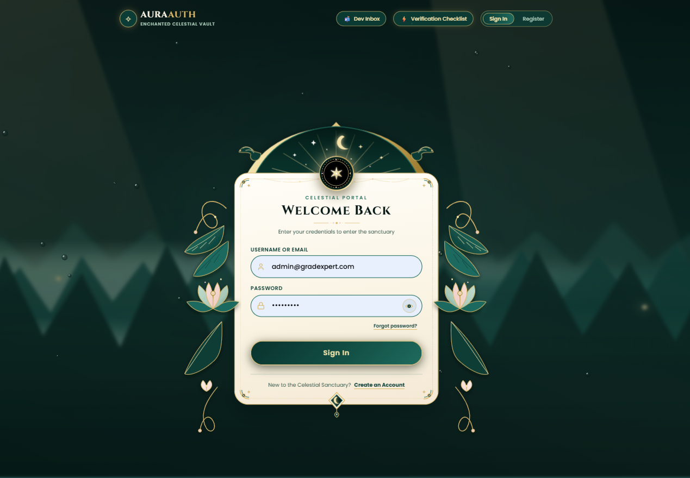
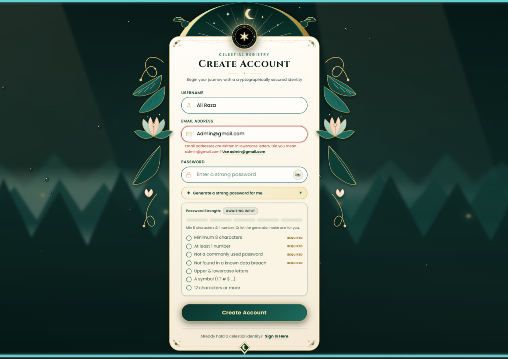
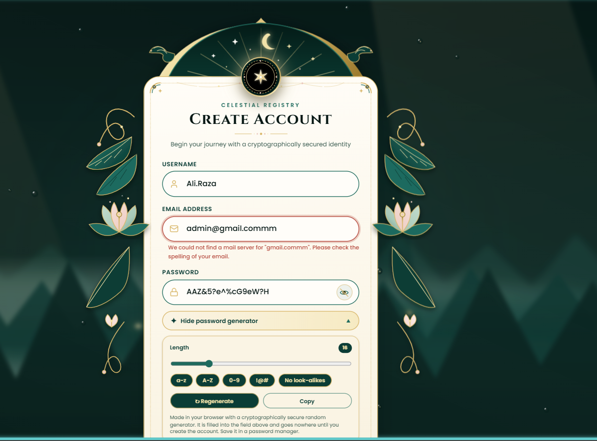
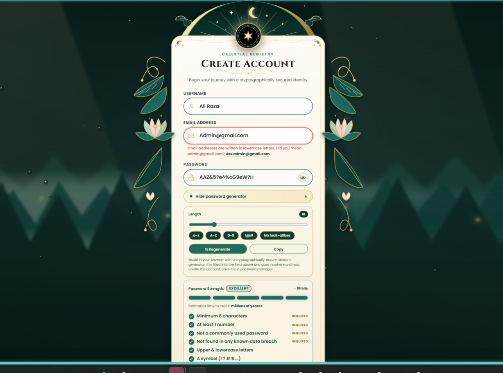
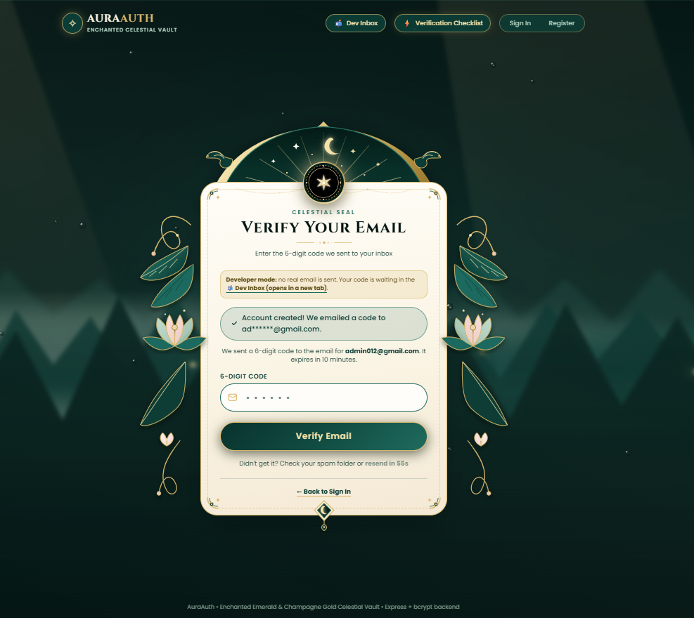

# AuraAuth: Login Authentication System (Full-Stack)

**Oasis Infobyte SIP · Web Development & Designing · Level 2, Task 4**

A complete login system with registration, secure sign-in, a protected dashboard and logout, built as **Option B** of the task card: **Node.js + Express + SQLite**, with **bcrypt** password hashing and **server-side sessions**. The interface is an ornate emerald-and-gold "celestial" design, and the project goes beyond the checklist with email verification, forgot password, a password strength meter and generator, breached-password blocking and account lockout.



---

## Contents

1. [Screenshots](#screenshots)
2. [Features](#features)
3. [Tech stack](#tech-stack)
4. [Run it on your laptop](#run-it-on-your-laptop)
5. [Task 4 checklist](#task-4-checklist)
6. [How it works (with the key code)](#how-it-works-with-the-key-code)
7. [Why there is a "Dev Inbox"](#why-there-is-a-dev-inbox)
8. [From Dev Inbox to real email (step by step)](#from-dev-inbox-to-real-email-step-by-step)
9. [Demo mode](#demo-mode)
10. [API](#api)
11. [Security design and honest limitations](#security-design-and-honest-limitations)
12. [Deploy online (optional)](#deploy-online-optional)
13. [Project structure and tests](#project-structure-and-tests)

---

## Screenshots

| | |
|---|---|
|  **Email rules.** `Admin@gmail.com` is refused because email addresses are written in lowercase. A one-click **Use admin@gmail.com** button fixes it. |  **Domain check.** The server looks the domain up in DNS. `gmail.commm` has no mail server, so the address is rejected with a clear message. |
|  **Password generator and strength meter.** Length 12-32, character sets, "no look-alikes", a 5-level meter with entropy and crack-time estimate, and a live checklist including the **data-breach check**. |  **Email verification.** After registering you must type the 6-digit code. In development the code is read from the **Dev Inbox** (explained below). |

---

## Features

**Required by the task**

- Registration (username, email, password) and login by username **or** email
- Password rule: **at least 8 characters and 1 number** (checked in the browser and again on the server)
- Duplicate username/email error
- One generic error for bad credentials: *"Invalid username/email or password."* (it never says which part was wrong)
- Protected dashboard that redirects to the login page when there is no session
- Logout that destroys the session and returns to login
- Passwords are **never stored in plain text** (bcrypt)
- Form validation on every form (no empty submissions)

**Extras**

- Email verification with a 6-digit code, plus **forgot password**
- Strict email checks: lowercase, Gmail's own rules, typo suggestions, disposable-mail blocking, **DNS lookup** of the domain
- 5-level **password strength meter**, **password generator** and **breached-password check** (Have I Been Pwned, k-anonymity)
- Change password and **sign out all devices**
- Account **lockout** after repeated wrong passwords
- SQLite database, persistent sessions, rate limiting, security headers
- 89 automated tests, favicon, responsive layout

---

## Tech stack

| Part | Technology |
|---|---|
| Front-end | React 19, Vite, TypeScript, Tailwind CSS |
| Back-end | Node.js 22.13+, Express |
| Database | SQLite through Node's built-in `node:sqlite` (JSON file fallback) |
| Password hashing | bcrypt (`bcryptjs`) |
| Sessions | random token in an **httpOnly, SameSite=Strict** cookie, stored server-side |
| Email | `nodemailer` (Gmail or any SMTP) or the built-in Dev Inbox |
| Tests | Node's built-in test runner |

---

## Run it on your laptop

1. Install **Node.js 22 LTS** from nodejs.org. Check with `node -v` (it must be 22.13 or higher).
2. Open the project folder in a terminal (in VS Code: Terminal > New Terminal) and run:

```powershell
npm install
npm test            # all tests should pass
npm run dev:all     # website on :3000 and API on :4000
```

3. Open **http://localhost:3000**.
4. Register an account. When the verification screen appears, click **📬 Dev Inbox** in the top bar (it opens in a new tab), copy the 6-digit code, paste it, and sign in.
5. Stop everything with **Ctrl + C**.

> If `npm install` fails with `ERESOLVE`, run `npm install --legacy-peer-deps` (the project already ships a `.npmrc` that does this for you).

**Useful variations**

```powershell
# Skip email verification completely (registering works instantly, like the task describes):
Copy-Item .env.example .env       # then put REQUIRE_EMAIL_VERIFICATION=off in .env

# Start with a fresh, empty database:
Remove-Item -Recurse -Force server\data

# Production-style run (one server for site + API) on http://localhost:4000:
npm run build
npm start
```

---

## Task 4 checklist

| Requirement from the task card | Where it is done |
|---|---|
| Registration page with username/email + password | `src/App.tsx` (register form), `POST /api/register` |
| Password: min 8 characters, at least 1 number | `shared/passwordPolicy.js`, enforced again in `server/authService.js` |
| Duplicate username/email error | `store.isTaken()` plus a `UNIQUE` constraint in SQLite |
| Login page with username/email + password | `src/App.tsx`, `POST /api/login` |
| Clear error that does not reveal which field is wrong | `INVALID_CREDENTIALS` in `server/authService.js` (same message and timing for a wrong user and a wrong password) |
| Protected dashboard, redirect without a session | the page asks `GET /api/me` first; no session means redirect to `#/login` |
| Logout clears the session and redirects | `POST /api/logout` destroys the server session and the cookie |
| Passwords hashed, not plain text | bcrypt, cost 12, random salt per password (`server/hasher.js`) |
| Form validation on both pages | `src/App.tsx` (client) and `server/authService.js` (server) |

---

## How it works (with the key code)

**Registration.** The browser validates the form, then `POST /api/register` runs on the server: validate username, **email** and password, check the password against known breaches, check for duplicates, hash with bcrypt, save, then send a verification code. The account cannot sign in until the code is entered.

**Password hashing** (`server/hasher.js`). bcrypt adds a random salt to every password and is deliberately slow, so guessing is expensive. A dummy comparison runs for unknown users so the response time does not reveal which accounts exist:

```js
import bcrypt from 'bcryptjs';

export function createBcryptHasher(rounds = 12) {
  const dummyHash = bcrypt.hashSync(`dummy-${Math.random()}-${Date.now()}`, rounds);
  return {
    hash: (password) => bcrypt.hash(password, rounds),
    compare: (password, hash) => bcrypt.compare(password, hash),
    dummyCompare: async (password) => {
      await bcrypt.compare(password, dummyHash);
      return false;
    },
  };
}
```

**Login and session** (`server/routes.js`). On success the server creates a random token, keeps only its hash in SQLite, and gives the browser an **httpOnly** cookie. Page JavaScript can never read the token:

```js
const cookieOptions = {
  httpOnly: true,       // JavaScript on the page can never read the session token
  sameSite: 'strict',   // never sent on cross-site requests (CSRF protection)
  secure: config.isProd, // HTTPS only in production
  path: '/',
};
```

**Protected dashboard.** The front-end calls `GET /api/me` before drawing the dashboard. If the server answers `401`, the user is sent to `#/login`. Because the session lives on the server, editing the browser's storage cannot fake a login.

**Email rules** (`shared/emailPolicy.js`, used by browser and server):

```js
validateEmail('Admin@gmail.com');
// { ok: false,
//   message: 'Email addresses are written in lowercase letters. Did you mean admin@gmail.com?',
//   suggestion: 'admin@gmail.com' }

validateEmail('ridazaibb04@gmail.com');
// { ok: true, email: 'ridazaibb04@gmail.com' }
```

After the format rules, the server looks the domain up in DNS (`server/emailDomain.js`), which is why `admin@gmail.commm` is rejected.

**Verification codes** (`server/authService.js`). Random 6 digits (`crypto.randomInt`), valid for 10 minutes, single use, five wrong guesses destroy the code, a new code can be requested every 60 seconds, and only an **HMAC** of the code is stored. A verify code cannot be used as a reset code.

---

## Why there is a "Dev Inbox"

Email verification and forgot password need to **send an email**. A server cannot send email by itself: it needs a sending account (for example a Gmail with an App Password) and secret credentials. That creates problems while developing or when someone else just wants to try the project:

- Whoever runs the project would first have to create and configure an email account.
- Real emails need internet and can land in spam or hit daily limits.
- Testing would send messages to real inboxes.
- A reviewer or teacher cannot be expected to enter their own credentials.

So in development the app uses a **Dev Inbox**: a pretend mailbox inside the app. Nothing is sent anywhere. Instead of delivering an email, the server keeps the message in memory and shows it on a page you open with the **📬 Dev Inbox** button (top bar) or at `/#/inbox`. You copy the code from there into the verification screen. The whole flow (register, code, verify, sign in, forgot password) works with **zero setup, offline**.

This is what the server does in that mode (`server/mailer.js`):

```js
if (effectiveMode === 'inbox') {
  inbox.unshift({ id: nextId++, to, subject: message.subject, text: message.text,
                  purpose, code, ttlMinutes, sentAt: new Date().toISOString() });
  log.log(`[Dev Inbox] New "${purpose}" email for ${to}. Open the app's "Dev Inbox" page to read it.`);
  return { sent: true, mode: 'inbox' };
}
```

**Limits you should know (and say in your report):**

- The code never reaches a real inbox, so it **cannot prove** an address belongs to the person typing it. Any well-formed address is accepted.
- Anyone using the app on that machine can read the codes, so the page is **switched off automatically in production** (`NODE_ENV=production`).
- Messages live in memory and disappear when the server restarts.

Think of it as a test double for a mail server: perfect for development and demos, not for real users.

---

## From Dev Inbox to real email (step by step)

Moving to real email needs **no code change**, only settings in a `.env` file. The server needs one **sender account**; the code is then emailed to **whatever address each user registers with**.

### Option A: Gmail (free)

1. Create a **separate Gmail** just for this (for example `auraauth.app@gmail.com`), so your personal account is never involved.
2. In that account open **myaccount.google.com > Security > 2-Step Verification** and turn it on.
   - **Important:** Google only offers App Passwords when 2-Step Verification is on and **not only through passkeys or security keys**. If the App passwords option is missing, add another second step (for example an authenticator app or a phone prompt) and look again.
3. Open **myaccount.google.com/apppasswords**, name it `AuraAuth` and create it. Copy the 16 characters (spaces are fine, the server removes them). It is shown only once.
4. In the project folder create your settings file:

   ```powershell
   Copy-Item .env.example .env
   ```

5. Open `.env` and set:

   ```
   SMTP_USER=auraauth.app@gmail.com
   SMTP_PASS=abcd efgh ijkl mnop
   ```

   As soon as `SMTP_USER` is filled in, the server switches from Dev Inbox to real email by itself (`mailMode` becomes `smtp`). Leave `DEMO_SHOW_CODES` unset.
6. **Test the sender** before the full app:

   ```powershell
   npm run test:mail -- your.personal@gmail.com
   ```

   It logs in, sends one test email (dummy code `123456`) and, if something is wrong, tells you exactly what. Check the inbox **and the spam folder**.
7. Restart the server (`Ctrl + C`, then `npm run dev:all`). The terminal should show the SMTP mode and `SMTP login: OK`.
8. Register with a real address. The code arrives in **that** address's inbox. The Dev Inbox button disappears because real email is now in use.

### Option B: another email service

Any SMTP provider works (for example Brevo, SMTP2GO or Mailjet). Use the host and login from the provider's SMTP page:

```
SMTP_HOST=smtp-relay.brevo.com
SMTP_PORT=465
SMTP_USER=<login shown by the provider>
SMTP_PASS=<SMTP key from the provider>
MAIL_FROM=AuraAuth <your verified sender address>
```

Providers usually want a **verified sender** (often a domain), so set `MAIL_FROM` to it. Without your own domain, messages may land in spam or the plan may limit sending. These services were not tested with this project: always run `npm run test:mail` first and read the provider's current requirements (some ask for a phone number at signup).

### Going live with real email (Render)

In the Render dashboard (**Environment** tab): add `SMTP_USER` and `SMTP_PASS`, **delete** `DEMO_SHOW_CODES`, and delete `REQUIRE_EMAIL_VERIFICATION` (or set it to `on`). Redeploy. Visitors now get real codes.

### Troubleshooting

| What you see | Likely cause and fix |
|---|---|
| `Invalid login` / `535` | You used your normal Gmail password. Use the **App Password**. |
| No App passwords page | 2-Step Verification is off, or only passkeys/security keys are set, or the account is a school/work account. Add another second step or use a personal Gmail. |
| `ETIMEDOUT`, `ECONNREFUSED`, `ENOTFOUND` | No internet, or port 465 is blocked. Try `SMTP_PORT=587`. |
| Email does not arrive | Check **spam**. First messages from a new sender often land there. |
| Code still shows in the Dev Inbox | `SMTP_USER` is empty or `DEMO_SHOW_CODES=on` is set. Fix `.env` and restart. |
| Daily limit reached | A free Gmail sends about 500 messages a day. |

### Keep your sender safe

- `.env` holds a secret. It is in `.gitignore`: never commit it, never put it in a zip, never show it on screen or in a demo video.
- Create a **separate App Password for each project**, so one leak can be revoked alone.
- If it ever leaks, delete the App Password at **myaccount.google.com/apppasswords** right away. Deleting the file from GitHub is not enough because it stays in the history.
- Use this Gmail only for sending mail. Do not use it as a recovery address or login for other accounts.

---

## Demo mode

A public website can deliver a code only by real email. To **show the forgot-password flow online without any email account**, set `DEMO_SHOW_CODES=on`: the 6-digit code is displayed on screen (with a "Demo mode" box and a "Use this code" button) instead of being emailed. The included `render.yaml` turns it on together with `REQUIRE_EMAIL_VERIFICATION=off`, so registering works instantly and only forgot password uses a code.

**Be honest about it in your report:** because the code appears on screen for whoever asks, **anyone can reset any account's password**. That is acceptable for a demo with throwaway accounts and never for real users. Unknown usernames still get an identical-looking reply (with a fake code that does not work), so the demo does not reveal which accounts exist.

If a public site has neither SMTP nor demo mode, the server turns email verification off by itself and hides "Forgot password?", so nobody is locked out waiting for a code that cannot arrive.

---

## API

| Route | Purpose |
|---|---|
| `POST /api/register` | Validates input, blocks weak/common/breached passwords and bad emails, rejects duplicates, stores a bcrypt hash, sends a verification code |
| `POST /api/verify-email` | Confirms the 6-digit code; only then can the account sign in |
| `POST /api/resend-verification` | New code (same reply for every account) |
| `POST /api/login` | Verifies credentials and starts a session cookie. Wrong user and wrong password give the same message |
| `POST /api/logout` / `POST /api/logout-all` | End this session / every session |
| `GET /api/me` | Current user, or `401`. The dashboard asks this first |
| `POST /api/forgot-password` | Emails a reset code (same reply for every account) |
| `POST /api/reset-password` | Code + new password (policy + breach check); signs out every device |
| `POST /api/change-password` | Needs the current password; signs out other devices |
| `GET /api/breach/range/:prefix` | Breach lookup proxy (only a 5-character hash prefix) |
| `GET /api/config` | Public: mail mode and whether verification is on |

---

## Security design and honest limitations

**Design**

- **bcrypt** (cost 12), salted. Plain passwords are never stored or logged.
- **Server-side sessions**; the browser holds only a random 256-bit token in an httpOnly, SameSite=Strict cookie (`Secure` in production). New token on every login; logout destroys it on the server.
- **Uniform errors** plus a dummy bcrypt comparison, so neither the message nor the response time reveals which accounts exist.
- **Account lockout**: 5 wrong passwords lock that username/email for 5 minutes (doubling on repeats, max 1 hour); fake usernames are locked the same way.
- **Rate limiting** per IP, **Helmet** security headers with a CSP, 10 KB body limit, an Origin check on state-changing requests.
- **SQLite with prepared statements only** (no SQL injection) and `UNIQUE` columns, so duplicates are impossible even if two sign-ups arrive at the same instant.
- **Breached-password blocking** with k-anonymity: the password's SHA-1 is computed locally and only its first 5 characters are sent to the breach service. A built-in list of very common passwords works offline.
- Codes are stored only as an **HMAC**; the "forgot" and "resend" replies are identical and instant for every account.

**Limitations**

- Account lockout lets someone deliberately lock another person's account for a few minutes; the lock is short and per-IP limits apply.
- The "already exists" message confirms an email is registered (the task card asks for it). A production app would email the owner instead.
- Without real email (Dev Inbox or demo mode) an address cannot be proven to belong to the user.
- Rate-limit and lockout counters live in server memory and reset on restart.
- The offline common-password list is small (about 250 entries); the online breach check covers the rest.
- Client-side checks are only for convenience; the server re-validates everything.

---

## Deploy online (optional)

Deploying is optional: the project runs fully on a laptop. A live link is only an extra.

**Where:** **Render** (free). The app has a real Node server with a database file, so it needs a host that keeps a Node process running (Render, Railway, Fly.io). **Vercel does not fit** (static sites and short-lived functions, no permanent disk).

If the project lives inside a repository together with other projects, use a *Web Service* with a **Root Directory**:

1. Push the project to GitHub first.
2. On **render.com** sign in with GitHub, then **New + > Web Service** and pick your repository.
3. Fill in:

   | Field | Value |
   |---|---|
   | Root Directory | the project's folder name (leave empty if it is the whole repository) |
   | Runtime | Node |
   | Build Command | `npm install --include=dev && npm run build` |
   | Start Command | `npm start` |
   | Instance Type | Free |

4. Add these environment variables:

   | Key | Value |
   |---|---|
   | `NODE_VERSION` | `22` |
   | `NODE_ENV` | `production` |
   | `TRUST_PROXY` | `1` |
   | `DEMO_SHOW_CODES` | `on` (see [Demo mode](#demo-mode)) |
   | `REQUIRE_EMAIL_VERIFICATION` | `off` |

5. Create the service. After a few minutes you get `https://auraauth-xxxx.onrender.com`; one address serves the site and the API.
6. Test: register, log in, dashboard, logout, forgot password.

(If the project is alone in its own repository you can use the included `render.yaml` through **New + > Blueprint**.)

**Free-tier limits:** the service sleeps after about 15 minutes without visitors and takes up to a minute to wake. The disk is wiped on redeploy, restart or sleep, so **registered users disappear** (fine for a demo). A workspace gets 750 free instance hours per month and there is no cap on the number of accounts. 

---

## Project structure and tests

```
server/        index.js (wiring) · app.js · routes.js · authService.js · db.js · sqliteStore.js ·
               sqliteSessions.js · sqliteCodes.js · loginGuard.js · hasher.js · breach.js ·
               emailDomain.js · mailer.js · mailTemplates.js · config.js · secret.js · sql.js
               (store.js, sessions.js, memoryCodes.js = JSON / in-memory fallback)
shared/        passwordPolicy.js · commonPasswords.js · emailPolicy.js   (used by browser AND server)
src/           App.tsx (UI) · EmailFlows.tsx (verify + forgot) · DevInbox.tsx (pretend mailbox) ·
               lib/api.ts · lib/breach.ts · artwork.ts · background.js · index.css
public/        favicon.svg / .ico, apple-touch-icon.png, icon-512.png (the browser-tab icon)
screenshots/   images used in this README
tests/         shared.test.js · server.test.js · email.test.js · http.test.js
scripts/       test-mail.js (sends one test email to check your SMTP settings)
render.yaml    Render deploy blueprint
.env.example   every setting, documented
```

Run the tests with `npm test`. They cover registration rules, hashing, sessions, lockout, SQLite, email rules, verification and reset codes, the mailer modes, and (with `npm install` done) the real Express routes with cookies.
